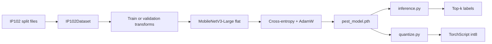

# Entomi

Entomi classifies 102 insect pest species from IP102. I trained MobileNetV3-Large with a replaced classification head in plain PyTorch, added top-1, top-5, and macro-F1 tracking, and kept the training, inference, and TorchScript export paths in one repository. The scripts also recognise the older checkpoint in my workspace: a MobileNetV3-Small backbone with separate order, family, and species heads. `inference.py` and `quantize.py` detect which checkpoint they were given from the state-dict keys, so both models load without a flag. The dataset and trained weights are not committed; IP102 is a 3.2 GB academic-use dataset and the checkpoints are gitignored.

```text
$ python inference.py --image_path ip102_v1.1/images/00002.jpg \
    --checkpoint best_pest_model.pth --classes ip102_v1.1/classes.txt --top_k 5
class   7 | 11.08% | Hemiptera / Delphacidae | Brown planthopper
class   9 |  7.57% | Hemiptera / Delphacidae | Small brown planthopper
class   8 |  0.97% | Hemiptera / Delphacidae | White-backed planthopper
class   3 |  0.35% | Lepidoptera / Crambidae | Asiatic rice borer
class   4 |  0.11% | Lepidoptera / Crambidae | Yellow rice borer
```

_Top-5 output from the hierarchical MobileNetV3-Small checkpoint on an IP102 validation image. The score is the product of the order, family, and species softmaxes, so the absolute numbers are low and should be read as a ranking._

## Contents

- [Results](#results)
- [Dataset](#dataset)
- [Requirements](#requirements)
- [Reproduce](#reproduce)
- [How it works](#how-it-works)
- [Configuration](#configuration)
- [Project layout](#project-layout)
- [Related projects](#related-projects)
- [Stack](#stack)

## Results

The flat MobileNetV3-Large path in `train.py` has no committed reference run. A run writes `training_history.json` with per-epoch loss, top-1, top-5, and macro F1; the repository does not carry one.

The older hierarchical checkpoint in my workspace has a 20-epoch history. These are the last-epoch validation numbers on IP102 v1.1 at 224 px:

| Head | Classes | Validation top-1 | Validation loss |
| --- | ---: | ---: | ---: |
| Order | 8 | 76.29% | 0.6844 |
| Family | 47 | 69.90% | 1.1142 |
| Species | 102 | 58.94% | 1.6068 |
| Recorded loss | - | - | 2.0095 |

The history is `training_history.json` in my workspace; it is not committed. The current `train.py` builds the flat Large model, so it does not reproduce the order and family columns. I keep the hierarchical checkpoint because it loads through the same inference and export scripts, not because it is the output of the current training script. The species column is the number comparable to the flat model: 58.94% top-1 on the validation split.

## Dataset

IP102 v1.1 contains more than 75,000 images across 102 classes with a long-tailed distribution. About 19,000 images also have bounding boxes, which this repository does not use. The official repository is [xpwu95/IP102](https://github.com/xpwu95/IP102).

The dataset is free for academic use only. For other purposes, contact the authors through the repository.

Download the v1.1 folder from the Google Drive link in the official repository, or use `gdown`:

```bash
pip install gdown
gdown --fuzzy "https://drive.google.com/drive/folders/1svFSy2Da3cVMvekBwe13mzyx38XZ9xWo"
```

Lay the result out as:

```text
ip102_v1.1/
├── images/
├── train.txt
├── val.txt
├── test.txt
└── classes.txt
```

The split files are space-separated `filename label` pairs. `classes.txt` lines are `1  Rice leaf roller`, and so on. `dataset.py` reads the split files with pandas and resolves images under `images/`. The dataset class supports `train`, `val`, and `test`; `train.py` uses train and validation only.

## Requirements

- Python 3.10 or newer.
- A CUDA GPU for training. CPU inference works and is what `inference.py` uses when CUDA is unavailable.
- About 3.2 GB of disk for IP102 v1.1 after extraction.
- Linux, macOS, or Windows. The untracked `setup.sh` uses `apt-get` and is Linux-only.

Install the Python dependencies:

```bash
git clone https://github.com/abderrahmenex86/Entomi
cd Entomi
python -m venv .venv
source .venv/bin/activate
pip install -r requirements.txt
```

## Reproduce

### Weights

The repository does not ship weights. Training writes three files:

| File | What it contains |
| --- | --- |
| `pest_model.pth` | Best validation macro-F1 state dict |
| `checkpoint.pth` | Best state dict plus optimizer, scheduler, and epoch |
| `last_checkpoint.pth` | State dict, optimizer, scheduler, and epoch from every epoch |

`inference.py` and `quantize.py` accept either the flat Large state dict or the hierarchical Small state dict. The default checkpoint name is `best_pest_model.pth`, which is the file in my workspace. After a fresh run, pass `--checkpoint pest_model.pth`.

### Train

```bash
python train.py
```

`train.py` has no command-line flags. The run uses 25 epochs, batch size 256, AdamW at `1e-3` with weight decay `1e-2`, cosine annealing over 25 epochs, cross-entropy with label smoothing `0.1`, 224 px inputs, and seed 1337. Edit the constants at the top of the script to change them.

The loop prints one block per epoch. These are the final-epoch fields from the hierarchical run in my workspace; the flat model prints the same fields with different values:

```text
Train Loss: 1.6475
Train Accuracy -> 63.82%
Val Loss: 2.0095
Val Accuracy -> 58.94%
Checkpoint saved.
Last Checkpoint saved.
```

The block is trimmed to the fields recorded in the historical JSON. The current flat run also prints top-5 and macro F1 between the accuracy and validation lines; a new run writes all of them to `training_history.json`.

### Evaluate

There is no separate evaluation entry point. `train.py` evaluates the validation split every epoch, and `inference.py` runs one image at a time:

```bash
python inference.py \
  --image_path ip102_v1.1/images/00002.jpg \
  --checkpoint pest_model.pth \
  --classes ip102_v1.1/classes.txt \
  --taxonomy taxonomy.json \
  --top_k 5
```

The output has one line per class:

```text
class   7 | 11.08% | Hemiptera / Delphacidae | Brown planthopper
class   9 |  7.57% | Hemiptera / Delphacidae | Small brown planthopper
```

The class id is zero-based. The label comes from `classes.txt`; the order and family come from `taxonomy.json`. If a class has no taxonomy entry, the line shows `unknown / unknown`.

### Export

```bash
python quantize.py \
  --checkpoint pest_model.pth \
  --output quantized_pest_model.pt
```

The export dynamically quantizes `nn.Linear` layers to int8 and writes TorchScript, not ONNX. On a flat MobileNetV3-Large checkpoint the size went from 16.73 MB to 13.02 MB (1.28x). On the hierarchical Small checkpoint it went from 4.01 MB to 3.92 MB (1.02x). The limited gain is expected: most of MobileNetV3's parameters are in convolutional layers, and dynamic quantization only touches the linear heads.

## How it works

The training path is a flat classifier. The validation and inference path also supports the older hierarchical checkpoint.

1. `dataset.py` reads `train.txt` or `val.txt` with pandas, joins each filename to `images/`, opens the image as RGB, and applies the transform. A file that fails to decode advances to the next index; the epoch therefore gets a duplicate of the next sample rather than a clean skip.
2. Training uses `RandomResizedCrop(224, scale=(0.6, 1.0))`, horizontal flip, color jitter, tensor conversion, and ImageNet normalization. Validation uses `Resize(256)`, `CenterCrop(224)`, tensor conversion, and the same normalization.
3. `PestClassifier` loads MobileNetV3-Large with ImageNet weights and replaces `classifier[3]` with `Linear(1280, 102)`.
4. The loss is cross-entropy with label smoothing `0.1`. Metrics are top-1, top-5, and macro F1 across 102 classes.
5. The optimizer is AdamW with one parameter group. The scheduler is cosine annealing over the epoch count. The best validation macro-F1 state is written to `pest_model.pth`; `last_checkpoint.pth` is overwritten every epoch.
6. `HierarchicalPestClassifier` is the older path: MobileNetV3-Small features, global average pooling, and three linear heads for 8 orders, 47 families, and 102 species. `inference.py` detects it by the `backbone.` prefix in the state dict and ranks species by the product of the three softmaxes.
7. `quantize.py` uses the same detection, applies dynamic int8 quantization to the linear layers, scripts the model, and saves the result.



## Configuration

`train.py` is configured by constants, not flags:

| Setting | Default | Location |
| --- | --- | --- |
| Epochs | 25 | `train.py` |
| Batch size | 256 | `train.py` |
| Optimizer | AdamW, `lr=1e-3`, `weight_decay=1e-2` | `train.py` |
| Scheduler | CosineAnnealingLR, `T_max=25` | `train.py` |
| Loss | Cross-entropy, label smoothing `0.1` | `train.py` |
| Input size | 224 | `train.py` |
| Dataset root | `ip102_v1.1` | `train.py` |
| Seed | 1337 | `train.py` |

Inference flags:

| Flag | Default | What it does |
| --- | --- | --- |
| `--image_path` | required | Image to classify |
| `--checkpoint` | `best_pest_model.pth` | Flat or hierarchical state dict |
| `--classes` | `ip102_v1.1/classes.txt` | Class names, one `index  name` per line |
| `--taxonomy` | `taxonomy.json` | Class id to order and family |
| `--top_k` | 5 | Number of predictions to print |

Export flags:

| Flag | Default | What it does |
| --- | --- | --- |
| `--checkpoint` | `best_pest_model.pth` | State dict to quantize |
| `--output` | `quantized_pest_model.pt` | TorchScript output path |

## Project layout

| Path | What it is |
| --- | --- |
| `train.py` | Training entry point and all training constants |
| `dataset.py` | `IP102Dataset` and split-file parsing |
| `model.py` | Flat `PestClassifier` and hierarchical `HierarchicalPestClassifier` |
| `helpers.py` | Training and evaluation loops, metrics, checkpoints |
| `inference.py` | Single-image top-k CLI with checkpoint detection |
| `quantize.py` | Dynamic int8 quantization to TorchScript |
| `taxonomy.json` | 102 class ids mapped to order and family strings |
| `classes.txt` | Class names in my workspace; also present inside `ip102_v1.1/` |
| `requirements.txt` | Python dependencies |
| `setup.sh` | My Linux setup script; untracked and not required |

## Related projects

- [Flora](https://github.com/abderrahmenex86/Flora) for plant species classification
- [Lesioni](https://github.com/abderrahmenex86/Lesioni) for plant disease segmentation

## Stack

| Component | Version / floor | Notes |
| --- | --- | --- |
| Python | 3.10+ | Floor from the project statement |
| PyTorch | 2.11.0 | `requirements.txt` asks for 2.0+ |
| torchvision | 0.26.0 | `requirements.txt` asks for 0.15+ |
| torchmetrics | 1.9.0 | `requirements.txt` asks for 1.0+ |
| pandas | 3.0.2 | `requirements.txt` asks for 2.0+ |
| Pillow | 12.2.0 | `requirements.txt` asks for 10.0+ |
| tqdm | 4.67.3 | `requirements.txt` asks for 4.66+ |
